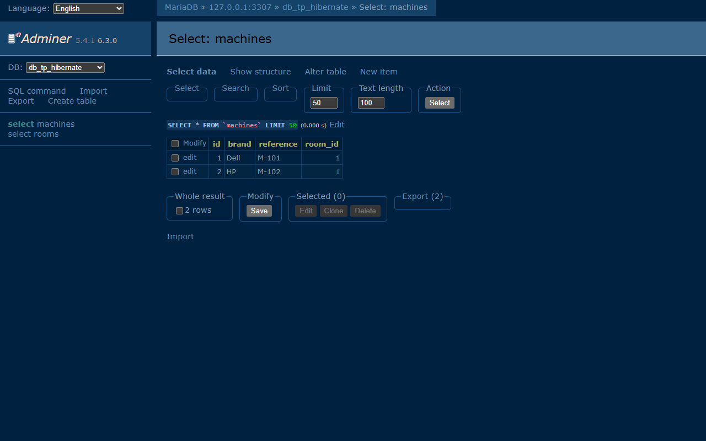

# J2E-TP4 — Hibernate & persistance des données

TP 4 du cours *Architecture Microservices* — persistance Java avec **Hibernate 5.6 + MySQL**, architecture en couches.



## Stack

`Java 17` · `Maven` · `Hibernate 5.6` · `MySQL` · `JUnit 5`

## Lancer

```bash
# Tests (H2 en mémoire, aucune base requise)
mvn test

# Démo sur MySQL : crée 1 salle + 2 machines
mvn exec:java
```

Base à créer au préalable :

```sql
CREATE DATABASE db_tp_hibernate;
```

## Architecture

```
entities/   Room, Machine      @OneToMany / @ManyToOne
dao/        IDao<T>, RoomDao, MachineDao + requêtes HQL
services/   RoomService, MachineService
util/       HibernateUtil (SessionFactory unique)
test/       MainTest
```

Tables générées par Hibernate (`hbm2ddl.auto=update`) : `rooms`, `machines`.

## Résultat

```
=== Persisted data ===
  Room{id=1, code='IT-01', label='Computer Lab'}
  Machine{id=1, reference='M-101', brand='Dell'} -> room IT-01
  Machine{id=2, reference='M-102', brand='HP'} -> room IT-01
Machines of brand Dell: 1
Machines in room IT-01: 2
```

**Tests : 15/15** — `MachineDaoTest` (6), `RoomDaoTest` (7), `ServiceLayerTest` (2).

Auteur : [zAK4-7](https://github.com/zAK4-7)
